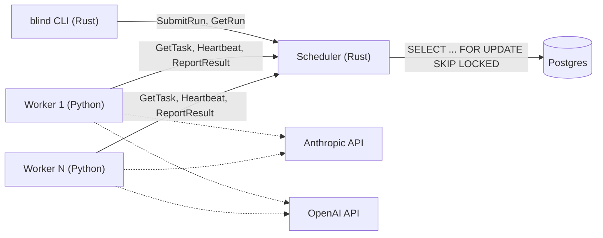

# Double Blind

A distributed, fault-tolerant LLM evaluation platform. CLI command: `blind`.

Judge scoring is blinded to both model identity and response position/order, to control for the position bias and self-preference bias that LLM-as-judge setups are known to suffer from.



One scheduler, a Postgres-backed queue, and any number of worker processes pulling from it independently — adding workers is just starting more processes, no coordination between them required.

## Architecture

- **Scheduler** (Rust): expands a run request into individual tasks, validates that the judge isn't among the models being evaluated, computes content-addressed task IDs, and writes tasks to the Postgres-backed queue. Exposes the gRPC service that both the CLI and workers talk to. Also serves `GetRun`, computing the leaderboard as a plain SQL aggregate (mean score per model) directly against Postgres.
- **Queue** (Postgres): a `tasks` table. A worker that misses its heartbeat has its task automatically reclaimed by the same claim query used for fresh work (reassignment timeout defaults to 30s, configurable via `REASSIGNMENT_TIMEOUT_SECONDS`).
- **Workers** (Python): pull tasks over gRPC, call the contestant model and the judge model, score against the rubric, report results. Heartbeat interval defaults to 5s, configurable via `HEARTBEAT_INTERVAL_SECONDS`. Model calls are dispatched by model name prefix (`claude-*` → Anthropic, `gpt-*` → OpenAI) to a real `Client` implementation when `WORKER_CLIENT=real`. Otherwise, a deterministic `FakeClient` is used, which is also what the chaos test runs against.
- **Storage** (Postgres): task status for checkpointing, plus completed scores, verdicts, and per-criterion rationale.
- **CLI** (`blind`, Rust): a gRPC client to the scheduler. `blind run` submits an eval and polls until it's done; `blind show <run_id>` prints a completed run's results — a ranked leaderboard for rubric mode, or a win/loss/tie table per condition (plus the raw blind-vs-unblind win-rate shift) for pairwise mode.

## Project structure

```
scheduler/   Rust gRPC server - SubmitRun, GetTask, ReportResult, Heartbeat, GetRun
worker/      Python worker - claim/process/report loop, model/judge clients
cli/         Rust blind binary - a gRPC client to the scheduler
proto/       blind.proto - the gRPC contract shared by all three
db/          Postgres migrations
scripts/     chaos_test_tier2.py, scale_benchmark.py (see below)
docs/        assets referenced from this README
```

## Setup

1. A Postgres database (e.g. a free [Supabase](https://supabase.com) project). Add the connection string to `.env`:
   ```
   DATABASE_URL=postgresql://...
   ```
2. Run the migrations in `db/migrations/` against it.
3. Build both Rust binaries: `cargo build` (produces `scheduler` and `blind`).
4. Optional, for real model calls instead of the deterministic `FakeClient`: add `ANTHROPIC_API_KEY` and `OPENAI_API_KEY` to `.env`.

## Usage

Start the scheduler and at least one worker (each in its own terminal):

```
cargo run --bin scheduler

python -m worker                      # FakeClient - no API keys needed, deterministic
WORKER_CLIENT=real python -m worker   # real Anthropic/OpenAI clients
```

**Rubric mode** — score N models independently against a rubric, ranked by mean score:

```
$ cat models.yaml
models:
  - claude-opus-5
  - gpt-5

$ blind run --prompts tasks.jsonl --judge claude-sonnet-5

Run ID: run_8f2e1a

RUBRIC LEADERBOARD — run_8f2e1a
────────────────────────────────
 Rank  Model     Mean Score
  1    claude-opus-5   4.31
  2    gpt-5           3.94
────────────────────────────────
```

**Pairwise mode** — head-to-head comparison, blinded by default; `--compare` adds an unblinded pass to measure whether the judge's verdict shifts once identity is revealed:

```
$ blind run --models pair.yaml --prompts tasks.jsonl --judge claude-sonnet-5 --mode pairwise --compare

Run ID: run_9c4d02

PAIRWISE RESULTS — run_9c4d02
Pair: claude-opus-5 vs gpt-5

              claude-opus-5 wins gpt-5 wins ties
blinded       27                 19         4
unblinded     34                 13         3

Raw win rate for claude-opus-5: 54% blinded -> 68% unblinded (+14 pts when identity was revealed).

NOTE: this is a descriptive observation, not a significance test.
```

View a completed run again later with `blind show <run_id>`.

## Chaos test

A real worker process gets `SIGKILL`'d mid-task — no graceful shutdown, no chance to flush anything — and a second worker reclaims and completes it with exactly one result row. Recorded at the real 30-second reassignment timeout (`scripts/chaos_test_tier2.py`):


## Testing & benchmarks

```
cd scheduler && cargo test     # 67 tests, against a real Postgres database
pytest worker/tests/           # 49 tests

python scripts/chaos_test_tier2.py    # the real kill -9 shown above, runnable on demand
python scripts/scale_benchmark.py     # 1 vs N workers, measures the speedup for yourself
```

A faster, CI-safe version of the chaos test also runs as part of `cargo test`: it writes a stale-heartbeat task row directly and asserts `GetTask`'s claim query reclaims it, without spawning real processes or waiting out the reassignment window.